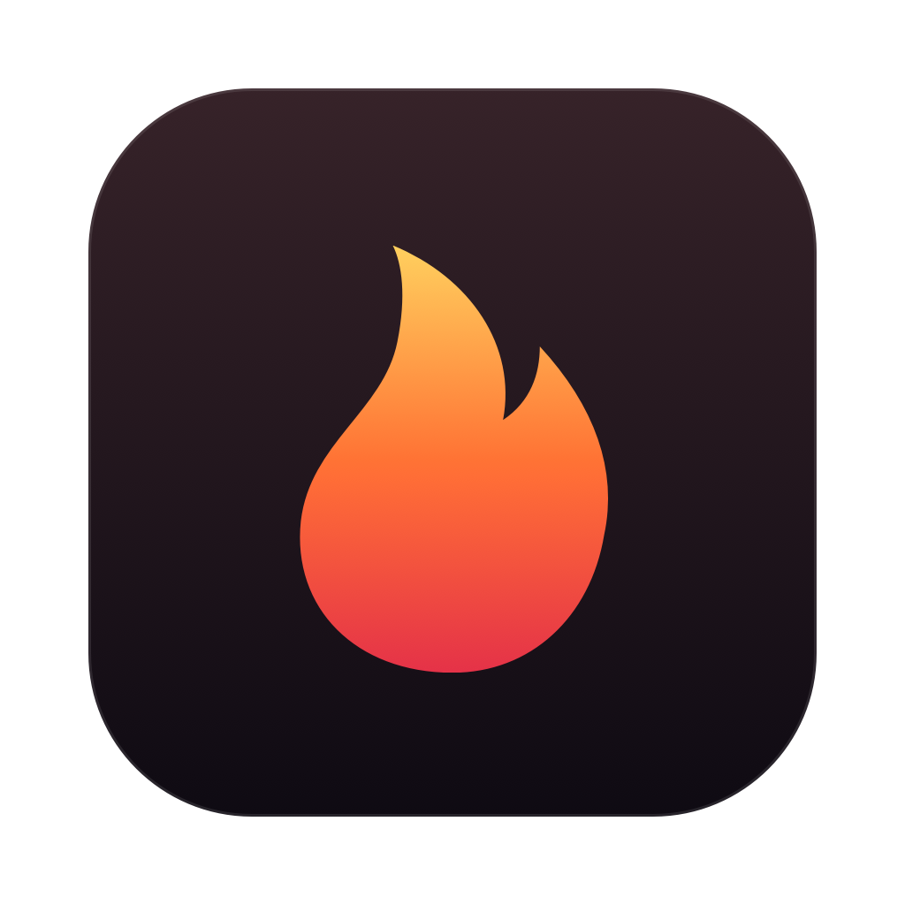
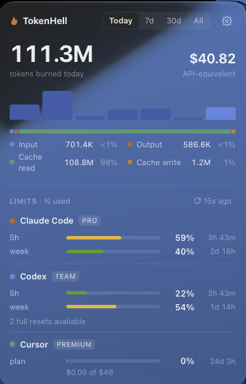
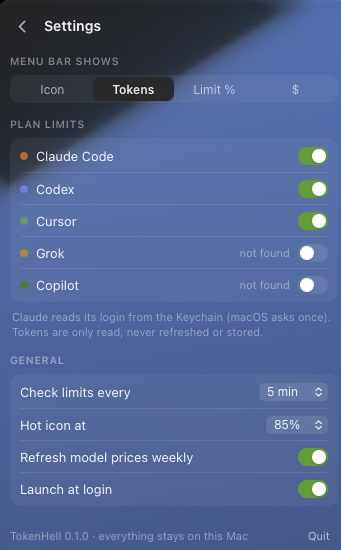

<div align="center">



# TokenHell

**See every token you burn, across every AI coding tool, right in your menu bar.**

Claude Code · Codex · Cursor · Grok · Copilot · Gemini CLI · OpenCode · Qwen · Kimi · Pi

[](#install)
[](https://v2.tauri.app)
[](https://svelte.dev)
[](LICENSE)


<br />


&nbsp;&nbsp;


</div>

---

You pay for Claude Max, a ChatGPT plan, Cursor, and maybe SuperGrok. Each one hides its usage on a different page with its own idea of a "limit". TokenHell reads all of them and puts the answer one click away:

- **🔥 Tokens burned:** today, 7 days, 30 days, or all time, with a daily sparkline split by app and the input / output / cache read / cache write mix.
- **💸 What it would cost at API prices.** Each request is priced on its own, so 1-hour cache writes, long-context tiers, fast mode, priority/flex tiers and web searches are all counted correctly. The Opus total matches a hand calculation from Anthropic's published rates to the cent.
- **⏳ Live plan limits:** Claude's 5h and weekly windows (including Opus-only), Codex 5h/week, Cursor's monthly plan, and Grok credits. Each shows % used and a countdown to reset. When any limit gets hot, the tray icon fills in. Codex full-reset credits show up on the Codex row; spending one asks for confirmation, then clears the limit.
- **🧊 Native Liquid Glass panel.** It's a real macOS 26 glass window, not a CSS imitation, and falls back to vibrancy on older systems. Light and dark mode both work.
- **🪶 Featherweight:** a 6.6 MB app that uses 0% CPU when idle. It watches files with FSEvents and only reads lines that are new.

## Why it's different

| | TokenHell | Typical usage trackers |
|---|---|---|
| Tools covered | 10 (CLI logs + Cursor/Grok/Copilot APIs) | usually one |
| Pricing | per request, with every tier and cache TTL | tokens × one flat rate |
| Live plan limits | Claude, Codex, Cursor, Grok, Copilot | rarely |
| History | kept after tools delete old logs (Claude Code purges after 30 days) | lost |
| Footprint | native tray app, ~6 MB | Electron or a terminal tab |

## Install

**Download:** grab `TokenHell_0.1.0_universal.dmg` from [**Releases**](https://github.com/ghostpengu/tokenhell/releases/latest). It runs on Apple Silicon and Intel, macOS 14+. Drag it to Applications.

The build is ad-hoc signed but not notarized, so macOS blocks the first launch. Click **Open Anyway** in *System Settings → Privacy & Security*, or run:

```sh
xattr -dr com.apple.quarantine /Applications/TokenHell.app
```

**Or build it yourself** (about two minutes):

```sh
git clone https://github.com/ghostpengu/tokenhell && cd tokenhell
pnpm install
pnpm tauri build --bundles app
open target/release/bundle/macos/TokenHell.app
```

You need Rust (stable), Node 20+, pnpm and Xcode Command Line Tools. To start it at login, use **Settings → Launch at login**.

> **Keychain prompts.** Live limits for Claude and Cursor need their login tokens, which live in the macOS Keychain. TokenHell reads them through `/usr/bin/security`, so one **Always Allow** is enough and survives app updates. If you deny it, TokenHell stays quiet for 30 minutes instead of asking again.

## Where the numbers come from

| Tool | Token history | Limits |
|---|---|---|
| **Claude Code** | `~/.claude/projects/**/*.jsonl` (deduped per request) | OAuth usage endpoint (token from Keychain) |
| **Codex** | `~/.codex/sessions`, per-response `token_usage_record` | `codex app-server` → `account/rateLimits/read` |
| **Cursor** | dashboard usage events, synced every 15 min. CLI turns the dashboard never lists come from an optional [`stop` hook](#cursor-cli) | `usage-summary`, plus the Grok weekly allowance |
| **Grok** | Grok Build `updates.jsonl`, grok-cli `grok.db` | SuperGrok credits |
| **Copilot** | — | `copilot_internal/user` |
| **Gemini CLI, OpenCode, Qwen, Kimi, Pi** | local session files / SQLite | — |

**Cost model.** Claude and Codex are priced per request from the [LiteLLM price map](https://github.com/BerriAI/litellm), refreshed weekly. Cursor dashboard events and Grok report their own cost for each request, and TokenHell uses that number. CLI hook turns have no reported cost, so they use that price list when the model is known. All `$` figures are *API-equivalent* (what the same usage would cost on the API), not your subscription bill.

The research behind each integration, including the undocumented bits, is in [`docs/research/`](docs/research). Notes on the Cursor CLI hook are in [`research/`](research).

### Cursor CLI

Cursor's dashboard does not list every CLI turn. Grok Bot Plan usage is the case this was built for: those turns never show up in `get-filtered-usage-events`. A `stop` hook records them locally as soon as the turn ends.

```sh
scripts/install-cursor-hook.sh
```

The script copies `hooks/cursor-usage-hook.rb` into Application Support, merges a `stop` hook into `~/.cursor/hooks.json`, and keeps a timestamped backup of that file. Run it again after pulling to refresh the script. Quit and reopen TokenHell once so the watcher attaches.

The hook writes token counts, the model, a timestamp, and the conversation and generation ids. It does not write prompts, responses, paths, or account email. It records **CLI builds only** (a `cursor_version` like `2026.11.05-86047df`). IDE agent turns are ignored, because the dashboard sync already has them and counting both would double the tokens. If the dashboard later starts listing these same CLI turns, they would be counted twice until the two feeds are reconciled. There is no dollar amount in the hook payload, so the cost is the public price for that model when one is known, and otherwise the tokens are shown without a price.

## Privacy

- **Local only.** TokenHell has no server, no analytics and no telemetry. The only network calls go to the providers' own usage endpoints and to the LiteLLM price list.
- **Numbers only.** It stores token counts, model names and timestamps in a local SQLite file under `~/Library/Application Support/io.github.ghostpengu.tokenhell/`. Prompts and responses are never stored. The optional Cursor hook follows the same rule: the JSONL it appends has counts and ids, not the turn text.
- **Credentials stay in memory.** They're read when needed, never written to disk, and never refreshed or sent anywhere except the provider they belong to.

## Develop

```sh
pnpm dev                              # UI only, in the browser, with mock data
pnpm app:dev                          # full app (vite + cargo)
cargo test --workspace                # parsers, pricing, limits
cargo run -p th-core --example scan -- /tmp/th.db --limits   # headless run on your real data
```

```
crates/th-core   ingestion (FSEvents + incremental JSONL), providers, limits, pricing, SQLite
src-tauri        tray, Liquid Glass panel, background workers, commands
ui               Svelte 5 panel: sparkline, token mix, limit gauges, per-tool breakdown
hooks/           Cursor CLI stop hook (token counts only)
scripts/install-cursor-hook.sh
```

To add a tool, implement `HistorySource` (token logs) or a `limits::poll` arm (plan limits). PRs are welcome, especially for Windsurf, Zed, Amp and Cline.

## License

MIT
